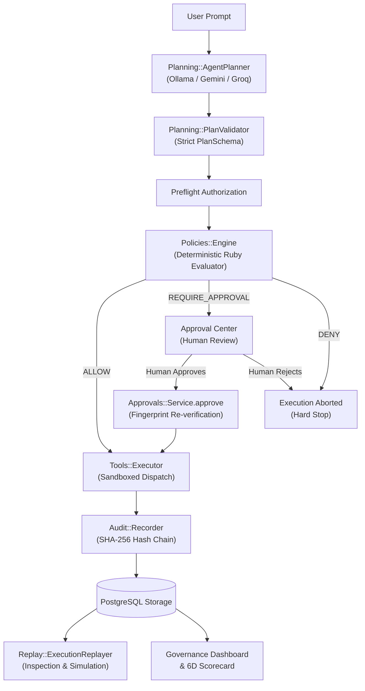

# VAISASTRAM — System Architecture

## 1. Architectural Philosophy

The defining principle of VAISASTRAM is:
**"AI proposes. Ruby decides. Humans approve."**

Traditional agent frameworks give LLMs autonomous tool execution power or rely on LLMs to self-evaluate their own risk. In VAISASTRAM, LLMs are treated as **untrusted planners**. An untrusted proposal cannot invoke tools, run queries, or interact with external services without going through a deterministic, fail-closed authorization gateway written in pure Ruby.

---

## 2. Subsystems

### A. Planning & Schema Validation (`app/services/planning/`)
- [`Planning::PlanSchema`](file:///Users/priyanshukumar/RailsApps/VAISASTRAM/app/services/planning/plan_schema.rb): Defines the strict contract for agent plans:
  - `mode`: `"conversation"` (for Q&A/clarifications) or `"action_plan"` (for multi-step tool execution).
  - `response`: Human-readable explanation. Must never claim past execution.
  - `steps`: Ordered collection with `step_number`, `action`, `arguments`, `description`.
- [`Planning::PlanNormalizer`](file:///Users/priyanshukumar/RailsApps/VAISASTRAM/app/services/planning/plan_normalizer.rb): Converts model output (markdown JSON blocks, raw JSON) into canonical hash representations.
- [`Planning::PlanValidator`](file:///Users/priyanshukumar/RailsApps/VAISASTRAM/app/services/planning/plan_validator.rb): Enforces type safety, prevents unexpected keys, checks step sequence, and screens for forbidden hallucinated past-tense completion strings.

### B. Independent Ruby Policy Engine (`app/services/policies/`)
- [`Policies::Engine`](file:///Users/priyanshukumar/RailsApps/VAISASTRAM/app/services/policies/engine.rb): Static gateway evaluating proposed actions.
- [`Policies::Context`](file:///Users/priyanshukumar/RailsApps/VAISASTRAM/app/services/policies/context.rb): Prepares request context, normalizes arguments, converts monetary figures to integer paise via `BigDecimal`, and computes SHA-256 action fingerprints.
- [`Policies::Evaluator`](file:///Users/priyanshukumar/RailsApps/VAISASTRAM/app/services/policies/evaluator.rb): Evaluates sorted rules by priority:
  - `UnregisteredToolRule`: Denies tools not in `Tool` registry.
  - `ToolPermissionRule`: Ensures user role has required permissions.
  - `PaymentLimitRule`: `<= ₹10,000` -> `REQUIRE_APPROVAL`; `> ₹10,000` -> `DENY`.
  - `FinancialSafetyRule`: Hard-denies deletion of financial records.
  - `FailClosedFallback`: Catches any engine exception and returns `DENY`.

### C. Human-in-the-Loop Approval System (`app/services/approvals/`)
- [`Approvals::Service`](file:///Users/priyanshukumar/RailsApps/VAISASTRAM/app/services/approvals/service.rb): Manages approval lifecycles (`pending` -> `approved` -> `executed` or `rejected` / `expired`).
- [`Approvals::FingerprintValidator`](file:///Users/priyanshukumar/RailsApps/VAISASTRAM/app/services/approvals/fingerprint_validator.rb): Cryptographically checks the SHA-256 fingerprint of current arguments against the snapshot taken at request time, detecting argument tampering.
- Segregation of duties: Operators cannot approve their own tasks.

### D. Sandboxed Tool Execution (`app/services/tools/`)
- [`Tools::Executor`](file:///Users/priyanshukumar/RailsApps/VAISASTRAM/app/services/tools/executor.rb): Centralized tool execution gateway.
  - No `eval`, `send`, or shell command execution.
  - Explicit Ruby `case action_key` routing.
  - Dispatches mock responses for authorized tools (`lookup_invoice`, `verify_invoice`, `prepare_payment`).
  - Never transfers real funds.

### E. Cryptographic Audit Trail & Replay (`app/services/audit/` & `app/services/replay/`)
- [`Audit::Recorder`](file:///Users/priyanshukumar/RailsApps/VAISASTRAM/app/services/audit/recorder.rb): Persists structured events using PostgreSQL advisory locks per chain. Each event references the previous event's SHA-256 hash.
- [`Audit::IntegrityVerifier`](file:///Users/priyanshukumar/RailsApps/VAISASTRAM/app/services/audit/integrity_verifier.rb): Validates complete hash chains on demand, reporting sequence discontinuities or tampered payloads.
- [`Replay::ExecutionReplayer`](file:///Users/priyanshukumar/RailsApps/VAISASTRAM/app/services/replay/execution_replayer.rb):
  - **Inspection Mode**: Reconstructs execution history from audit records without calling tools.
  - **Simulation Mode**: Re-evaluates steps against current live policies using mock responses, reporting policy drift.
